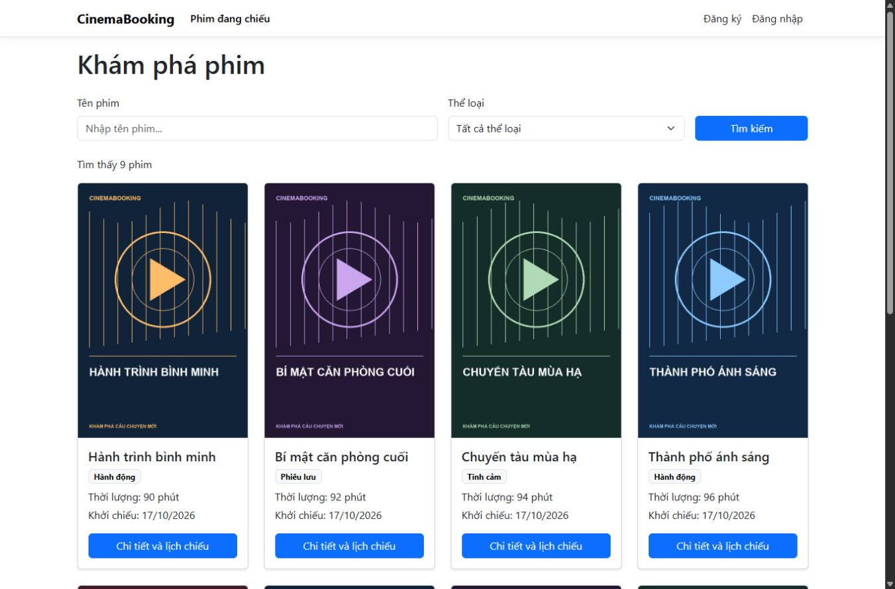
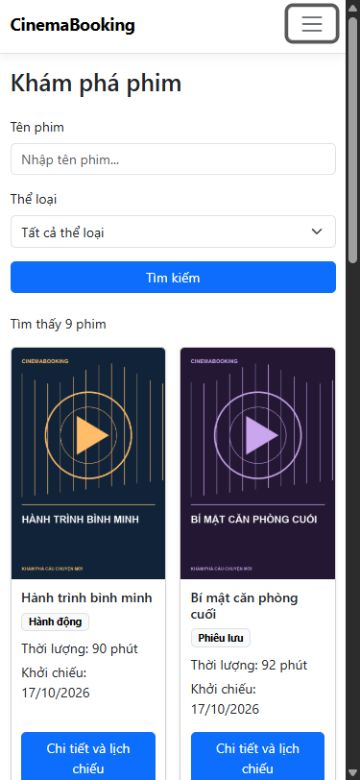

# CinemaBooking

Website đặt vé xem phim dành cho khách hàng và quản trị viên, xây dựng bằng **ASP.NET Core MVC, .NET 10, Entity Framework Core và SQL Server**.

Dự án đã hoàn thiện phạm vi bài tập lớn với luồng đặt vé, quản trị rạp và xác nhận thanh toán tại quầy. Repository có mã nguồn, migration, SQL dựng database, dữ liệu demo, hướng dẫn chạy và bộ kiểm thử tự động.

## Giao diện





*Giao diện sử dụng dữ liệu và poster minh họa của bản demo.*

## Chức năng

| Người dùng | Chức năng |
|---|---|
| Khách chưa đăng nhập | Xem danh sách phim, tìm kiếm, lọc thể loại, phân trang, xem chi tiết và lịch chiếu theo ngày, đăng ký và đăng nhập |
| Khách đã đăng nhập | Chọn ghế, xem trạng thái ghế qua AJAX, ghi nhớ lựa chọn bằng session, đặt vé, xem lịch sử và chi tiết vé của mình, cập nhật hồ sơ và đổi mật khẩu |
| Quản trị viên | Quản lý phim, thể loại, phòng, ghế và suất chiếu; đóng/mở bán; tìm đơn và xác nhận thanh toán tại quầy |

Các quy tắc chính:

- Mỗi đơn chọn tối đa 10 ghế. Server kiểm tra ghế và tính tiền theo giá suất chiếu.
- Trạng thái ghế cập nhật mỗi 5 giây. Session chỉ lưu lựa chọn, không giữ chỗ.
- Transaction và unique index `(ShowtimeId, SeatId)` ngăn bán trùng ghế trong cùng suất.
- Khách chỉ xem được đơn của mình. Chức năng quản trị yêu cầu vai trò `Admin`.
- Suất đã bắt đầu hoặc có đơn không được sửa/xóa. Đóng bán giữ nguyên vé đã đặt.
- Lịch cùng phòng phải chừa tối thiểu 15 phút dọn phòng.
- Các thao tác thay đổi dữ liệu có kiểm tra antiforgery; giao diện có trang lỗi và thông báo tiếng Việt.

## Công nghệ

| Thành phần | Công nghệ |
|---|---|
| Backend | ASP.NET Core MVC và Web API, .NET 10 |
| Truy cập dữ liệu | Entity Framework Core 10 và migrations |
| Database | SQL Server, mặc định dùng Express LocalDB |
| Tài khoản và phân quyền | ASP.NET Core Identity, role Admin và Customer |
| Frontend | Razor Views, Bootstrap, JavaScript, jQuery và AJAX |
| Lựa chọn ghế tạm | ASP.NET Core Session |
| Kiểm thử | Chương trình hồi quy gửi HTTP thật và dùng database SQL Server riêng |

## Yêu cầu cài đặt

- Windows với **.NET 10 SDK** và **SQL Server Express LocalDB**.
- Nếu dùng Visual Studio, chọn phiên bản hỗ trợ .NET 10, cài workload **ASP.NET and web development** cùng thành phần LocalDB.
- Git nếu lấy source bằng lệnh clone. Có thể dùng **Code → Download ZIP** và giải nén.
- Lần chạy đầu cần Internet để restore các gói NuGet.

Visual Studio và SQL Server Management Studio không bắt buộc khi chạy bằng script. Repository riêng tư yêu cầu tài khoản GitHub có quyền truy cập để clone.

## Chạy nhanh với dữ liệu demo

Mở PowerShell tại thư mục muốn lưu dự án:

```powershell
git clone https://github.com/ddwcsphung/CinemaBooking.git
cd CinemaBooking
.\START_DEMO.cmd
```

Cũng có thể mở trực tiếp `START_DEMO.cmd` bằng File Explorer.

Script chạy ở môi trường **Development**, kết nối LocalDB, tự áp dụng migration và bổ sung dữ liệu demo vào database **`CinemaBooking_Submission`**. Không cần chạy `Update-Database` hay cài `dotnet-ef` khi dùng cách này.

Chờ cửa sổ hiện `Now listening on`, sau đó mở **http://localhost:5175**. Giữ cửa sổ chạy trong lúc sử dụng, nhấn **Ctrl + C** để dừng.

### Tài khoản demo

| Vai trò | Email | Mật khẩu |
|---|---|---|
| Quản trị viên | `demo.admin@example.com` | `CinemaDemo@2026!` |
| Khách A | `demo.a@example.com` | `CinemaDemo@2026!` |
| Khách B | `demo.b@example.com` | `CinemaDemo@2026!` |

Đây là tài khoản và mật khẩu công khai dành cho demo trên máy cá nhân. Không sử dụng cấu hình này cho website công khai.

### Dữ liệu và kịch bản demo

Lần khởi tạo mới có 10 phim hư cấu, 3 thể loại, 4 phòng, 45 ghế, 9 suất chiếu, 12 đơn và 3 tài khoản. Một phim bị ẩn, một suất đóng bán và một số phòng có trạng thái phục vụ kiểm thử.

1. Đăng nhập khách, tìm phim **Hành trình bình minh**.
2. Chọn **ngày mai hoặc ngày kế tiếp** và một suất còn mở bán.
3. Chọn ghế, đặt vé, mở **Vé của tôi** và chi tiết đơn.
4. Đăng nhập Admin, mở **Quản trị → Quản lý đơn đặt vé**, tìm đơn và xác nhận thanh toán.
5. Khách mở lại chi tiết để xem trạng thái đã thanh toán.

Seeder tạo lịch theo giờ Việt Nam tại ngày chạy cộng 1–2 ngày. Chạy lại trong cùng ngày không tạo trùng; ngày mới bổ sung lịch tương lai và giữ nguyên các vé cũ. Mật khẩu tài khoản đã tồn tại không được đặt lại.

## Mở bằng Visual Studio

1. Mở `CinemaBooking.slnx`.
2. Nhấn phải project **CinemaBooking** → **Set as Startup Project**. Không chọn project kiểm thử.
3. Khởi tạo database bằng `START_DEMO.cmd` hoặc bộ SQL ở phần dưới, rồi dừng server đang chạy.
4. Chọn profile **http** và nhấn **Ctrl + F5**.

Profile `http` dùng http://localhost:5175. Profile `https` dùng https://localhost:7276 và cần chứng chỉ HTTPS phát triển được tin cậy trên máy.

Sau khi database đã được khởi tạo, cũng có thể chạy bằng terminal:

```powershell
dotnet run --project CinemaBooking --launch-profile http
```

Không chạy đồng thời hai server trên cùng cổng. Nếu từng cấu hình User Secrets cho dự án, kiểm tra xem `ConnectionStrings:DefaultConnection` có đang ghi đè cấu hình database mặc định hay không.

## Database

Mặc định ứng dụng kết nối `(localdb)\MSSQLLocalDB`, database `CinemaBooking_Submission`, bằng Windows Authentication.

### Dựng database từ SQL

Chọn cách này khi muốn xem hoặc dựng database bằng SQL Server Management Studio:

1. Kết nối SQL Server, ví dụ `(localdb)\MSSQLLocalDB`.
2. Mở [Database/CinemaBooking_Full.sql](Database/CinemaBooking_Full.sql) và chạy toàn bộ.
3. Kiểm tra kết quả cuối có `DATABASE_OK`.

Nếu máy có `sqlcmd`, có thể chạy `Database\CAI_DATABASE.cmd`. File tổng hợp đã chứa toàn bộ các bước nên không cần chạy thêm các file SQL riêng.

| File | Nội dung |
|---|---|
| [01_CreateDatabase.sql](Database/01_CreateDatabase.sql) | Tạo database nếu chưa tồn tại |
| [02_Schema.sql](Database/02_Schema.sql) | Tạo bảng, khóa, chỉ mục và lịch sử migration |
| [03_DemoData.sql](Database/03_DemoData.sql) | Nạp dữ liệu demo với lịch chiếu tương đối theo ngày chạy |
| [04_Verify.sql](Database/04_Verify.sql) | Kiểm tra dữ liệu, vai trò Admin, khóa ngoại và ghế trùng |

Nếu chạy riêng từng file, dùng thứ tự **01 → 02 → 03 → 04**. Các script không xóa database đang có; bước nạp demo từ chối ghi đè dữ liệu hiện có khi database không phù hợp.

Schema có 7 bảng nghiệp vụ chính, bảng nối `GenreMovie`, 7 bảng Identity và `__EFMigrationsHistory`. SQL bàn giao chỉ chứa dữ liệu demo. Các file `.mdf`, `.ldf`, `.bak`, mật khẩu thật và User Secrets không được đưa lên Git.

### Dùng SQL Server khác

Chạy bộ SQL trên server muốn sử dụng, sau đó cấu hình `ConnectionStrings:DefaultConnection` qua **Manage User Secrets** của project hoặc biến môi trường `ConnectionStrings__DefaultConnection`.

Ví dụ với SQL Server Express và Windows Authentication:

```json
{
  "ConnectionStrings": {
    "DefaultConnection": "Server=TEN_MAY\\SQLEXPRESS;Database=CinemaBooking_Submission;Trusted_Connection=True;MultipleActiveResultSets=true"
  }
}
```

Chạy bằng Visual Studio hoặc `dotnet run` để dùng cấu hình vừa đặt. `START_DEMO.cmd` luôn chủ động chọn LocalDB và database demo. Git đồng bộ mã nguồn cùng script SQL; dữ liệu phát sinh trên hai máy không tự đồng bộ.

## Cấp quyền Admin cho tài khoản riêng

Đăng ký tài khoản qua website, dừng ứng dụng rồi thêm email vào **Manage User Secrets**:

```json
{
  "SeedAdmin": {
    "Email": "email-ban-vua-dang-ky@example.com"
  }
}
```

Khởi động lại ở Development, sau đó đăng xuất và đăng nhập lại. Seeder chỉ cấp quyền cho tài khoản đã tồn tại. Thay email cấu hình không tự thu hồi quyền Admin của tài khoản trước đó.

## Kiểm thử

Từ thư mục chứa solution:

```powershell
dotnet build CinemaBooking.slnx
dotnet run --project tests/CinemaBooking.SmokeTests --no-build
```

Bộ kiểm thử tạo database có hậu tố ngẫu nhiên, áp dụng migration, gửi HTTP thật đến server localhost riêng và tự xóa database thử khi kết thúc. Tài khoản SQL cần quyền tạo/xóa database thử; chương trình không dùng database hoạt động của nhóm.

Kết quả kiểm tra ngày **19/10/2026**:

- 62 kiểm tra hồi quy đều đạt, gồm phân quyền, antiforgery, session, đặt ghế đồng thời, giá server, thanh toán lặp và rollback giao dịch.
- 9 kiểm tra trên database dựng từ SQL đều đạt, gồm đăng nhập, đặt vé và xác nhận thanh toán.
- Bộ SQL dựng được database mới, chạy lặp không tạo dữ liệu trùng và qua kiểm tra toàn vẹn.
- Source giải nén từ gói bàn giao build đạt 0 lỗi, 0 cảnh báo; launcher phục vụ Catalog thành công.

Chi tiết nằm trong [Database/KET_QUA_KIEM_TRA.json](Database/KET_QUA_KIEM_TRA.json) và [hướng dẫn kiểm thử](docs/kiem-thu.md).

Biến tùy chọn: `CINEMA_TEST_CONNECTION` để chọn SQL Server thử nghiệm, `CINEMA_TEST_RESULTS` để xuất kết quả JSON và `CINEMA_TEST_LOG` để lưu log khi thất bại. Không ghi chuỗi kết nối có mật khẩu thật vào tài liệu hoặc commit.

## Cấu trúc dự án

```text
CinemaBooking.slnx
CinemaBooking/
  Areas/Identity/       Trang tài khoản
  Controllers/          MVC và Web API
  Data/                 DbContext, seeder và thư mục Migrations
  Filters/              Xử lý lỗi backend
  Models/               Thực thể dữ liệu
  ViewModels/           Dữ liệu biểu mẫu và giao diện
  Views/                Razor Views
  wwwroot/              CSS, JavaScript và ảnh
Database/               Bộ SQL và hướng dẫn database
tests/                  Kiểm thử hồi quy
docs/                   Kiến trúc, ERD, API và kiểm thử
START_DEMO.cmd          Khởi chạy demo với LocalDB
```

## Phạm vi và giới hạn

- Thanh toán theo hình thức xác nhận tại quầy; chưa tích hợp thanh toán trực tuyến, email xác nhận, hủy hoặc hoàn tiền.
- Giao diện tiếng Việt, định dạng tiền vi-VN và giờ Việt Nam; chưa có chuyển đổi nhiều ngôn ngữ.
- Session trong bộ nhớ phù hợp demo một máy chủ, hết hạn sau 20 phút không hoạt động và mất khi ứng dụng khởi động lại.
- Các poster kèm theo là ảnh minh họa, không phải poster phim chính thức. Thông tin tài nguyên ở [ASSETS.md](CinemaBooking/wwwroot/images/ASSETS.md).

Tài liệu thêm: [kiến trúc và ERD](docs/kien-truc.md), [hướng dẫn database](Database/HUONG_DAN_DATABASE.txt), [hướng dẫn chạy và bàn giao](HUONG_DAN_NOP_BAI.txt).
