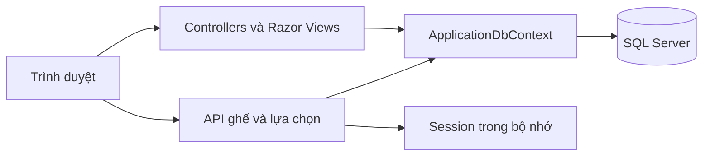
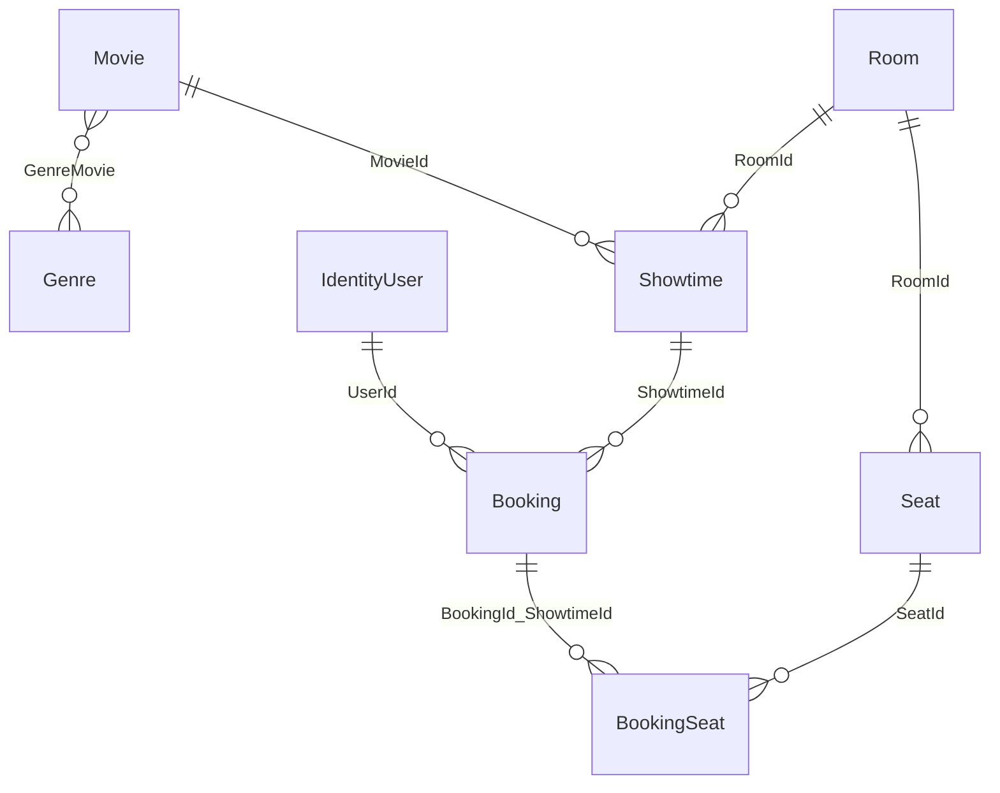

# Kiến trúc và quy tắc nghiệp vụ

## Các thành phần

Views Razor và Bootstrap tạo giao diện. JavaScript `booking-seats.js` đọc API trạng thái, lưu lựa chọn session và gửi form đặt vé. Controllers kiểm tra quyền và dữ liệu; `ApplicationDbContext` lưu Identity và nghiệp vụ vào SQL Server. Schema hiện có được quản lý bằng 6 migration.

## Quan hệ dữ liệu

Các bảng nghiệp vụ: Movies, Genres, GenreMovie, Rooms, Seats, Showtimes, Bookings, BookingSeats. Identity quản lý tài khoản/vai trò và các bảng liên quan.

- Unique `(RoomId, RowLabel, SeatNumber)` ngăn trùng vị trí ghế.
- Unique `(ShowtimeId, SeatId)` ngăn bán trùng ghế.
- Khóa ngoại ghép `(BookingId, ShowtimeId)` bảo đảm dòng ghế cùng suất với đơn.
- Tiền dùng decimal(18,2); thời điểm đặt lưu UTC, hiển thị UTC+7. Lịch chiếu dùng giờ Việt Nam.

## Luồng đặt vé

1. Người dùng đăng nhập, mở suất còn hoạt động trong tương lai, phim/phòng hoạt động và phòng có ghế sử dụng.
2. Trình duyệt tải trạng thái ghế và khôi phục tối đa 10 lựa chọn hợp lệ từ session theo tài khoản và suất.
3. AJAX cập nhật mỗi 5 giây khi tab hiện; lỗi mạng hoặc dữ liệu chưa đồng bộ khóa nút xác nhận. POST session có timeout 10 giây và hàng đợi giữ lựa chọn mới nhất.
4. POST đặt vé kiểm tra antiforgery và người dùng; mở transaction Serializable, lấy khóa cập nhật dòng suất trước khi đọc ghế.
5. Kiểm tra ghế đúng phòng, đang hoạt động, chưa được đặt và suất chưa bắt đầu; tính giá bằng dữ liệu SQL Server.
6. Lưu đơn và các ghế trong cùng transaction. Chỉ khi commit thành công mới báo thành công và xóa lựa chọn tạm.
7. Khi SQL Server hủy transaction do deadlock, tối đa 3 lần thử lại, mỗi lần đọc lại điều kiện. Không thử lại khi chưa xác định kết quả commit vì lỗi kết nối khác.

Đóng/mở bán và sửa suất dùng cùng khóa suất. Unique index là lớp bảo vệ cuối. Serializable được giữ để kiểm soát cập nhật phim, phòng và ghế cùng lúc.

## Hợp đồng API

| Phương thức | URL | Dữ liệu |
|---|---|---|
| GET | `/api/showtimes/{id}/seats` | `showtimeId`, `basePrice`, mảng `seats` với `seatId`, `rowLabel`, `seatNumber`, `isActive`, `isBooked` |
| GET | `/api/showtimes/{id}/selection` | `showtimeId`, `seatIds`, `removedSeatIds` |
| POST | `/api/showtimes/{id}/selection` | JSON `{ "seatIds": [1,2] }`; cùng cấu trúc phản hồi lựa chọn |

Các API yêu cầu đăng nhập. POST cần header `RequestVerificationToken` lấy từ trường ẩn antiforgery của form. Thiếu/null `seatIds`, ID trùng/âm, kiểu sai hoặc quá 10 bị từ chối; mảng rỗng xóa lựa chọn. Không trả dữ liệu cá nhân của người đã đặt ghế.

Mã HTTP chính: 200 thành công, 400 dữ liệu sai, 401 chưa đăng nhập, 403 sai quyền, 404 suất không tồn tại/không mở bán, 503 lỗi lưu trữ tạm thời. Phản hồi lỗi API có nội dung không bị đổi sang HTML bởi middleware trang lỗi.

## Quyền và bảo vệ

Controllers quản trị dùng role Admin. Khách chỉ được xem đơn có UserId của mình; đơn người khác trả 404. Các thao tác thay đổi dữ liệu kiểm tra antiforgery. Xác nhận thanh toán là cập nhật có điều kiện Unpaid → Paid nên gửi lại không tạo giao dịch mới. Không ghi mật khẩu, token hoặc chuỗi kết nối vào log ứng dụng.

## Sitemap

- Catalog → Chi tiết phim và ngày xem → Chọn ghế → Chi tiết đơn → Vé của tôi.
- Đăng ký/đăng nhập → Hồ sơ → Đổi mật khẩu → Đăng xuất.
- Quản trị → Phim, thể loại, phòng/ghế, suất chiếu, đơn đặt vé.
- Trang thông tin riêng tư, trang lỗi và không có quyền.

## Giao diện và quốc tế hóa

Giao diện hiện dùng tiếng Việt, định dạng tiền vi-VN và giờ Việt Nam. Đây chưa phải website nhiều ngôn ngữ. Khi mở rộng, tách chuỗi vào resource, cấu hình RequestLocalization và dùng IViewLocalizer/IStringLocalizer; giữ UTC cho dấu thời gian và chuyển múi giờ tại ranh giới hiển thị.

Session trong bộ nhớ phù hợp demo một máy chủ. Triển khai nhiều máy cần shared session cache, shared Data Protection keys, TLS, cấu hình secrets và chính sách vận hành. Nhiều tab cùng session có thể ghi đè lựa chọn; session không phải cơ chế giữ ghế hoặc hợp nhất thay đổi nhiều tab.
